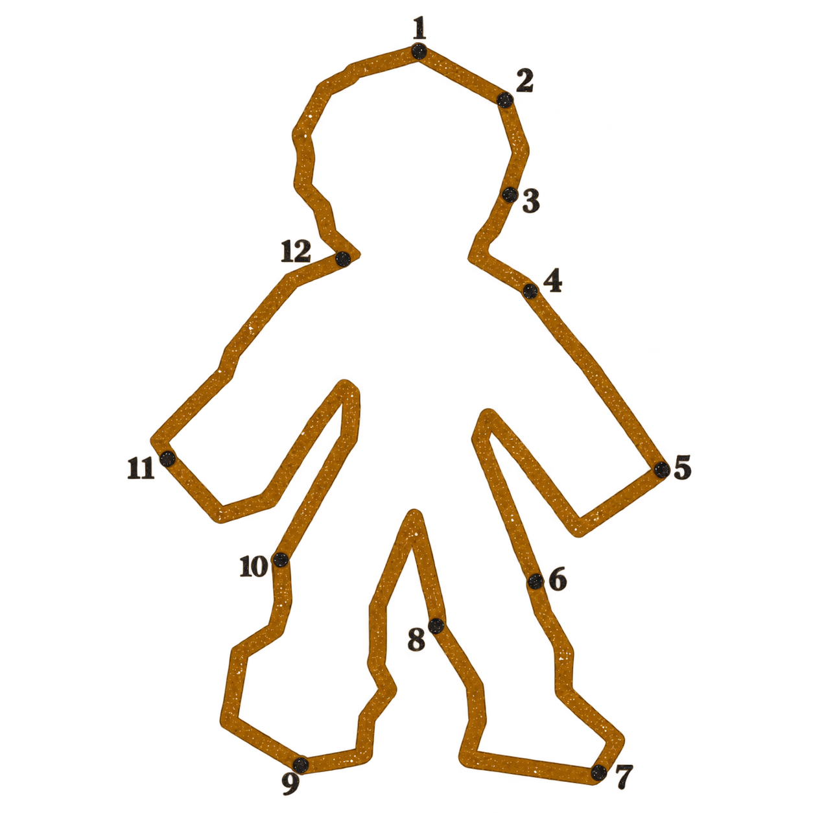
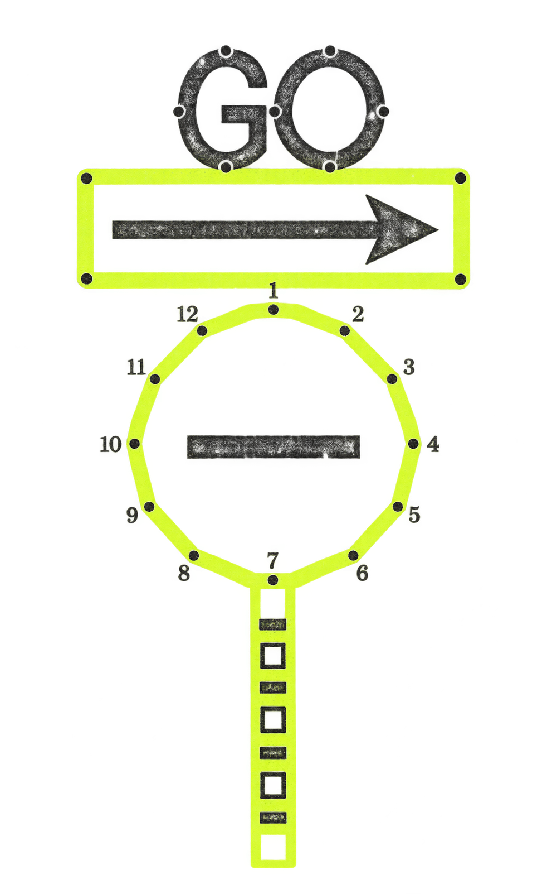
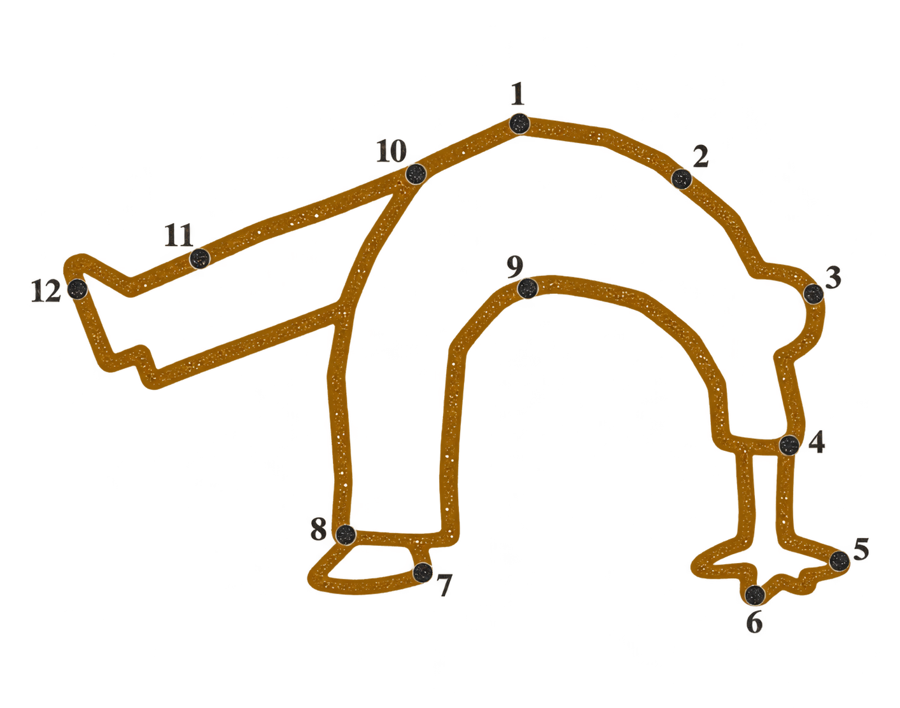

# 颗粒连点画生成器

Codex skill：`dot-outline-generator`。将物品图片转换为带编号节点的颗粒外轮廓，生成透明 PNG。主轮廓色从蓝、橙、荧光黄绿、浅粉、赭黄五种颜色中随机选择。

默认只保留主体外轮廓。已确认的路牌范例保留了 GO、箭头和禁止通行横杠，因为它们是识别该物品的关键细节。

## 使用

将本仓库克隆到 Codex 的 skills 目录，以图片附件为输入调用 `$dot-outline-generator`。例如：

> 请用 $dot-outline-generator 把这张图片转换成颗粒连点画透明 PNG。

风格规则在 [SKILL.md](SKILL.md)，色卡与参考图在 [assets](assets)。图像由内置图像生成工具制作；请检查编号是否连续、主体是否保真，以及背景是否真正透明。
